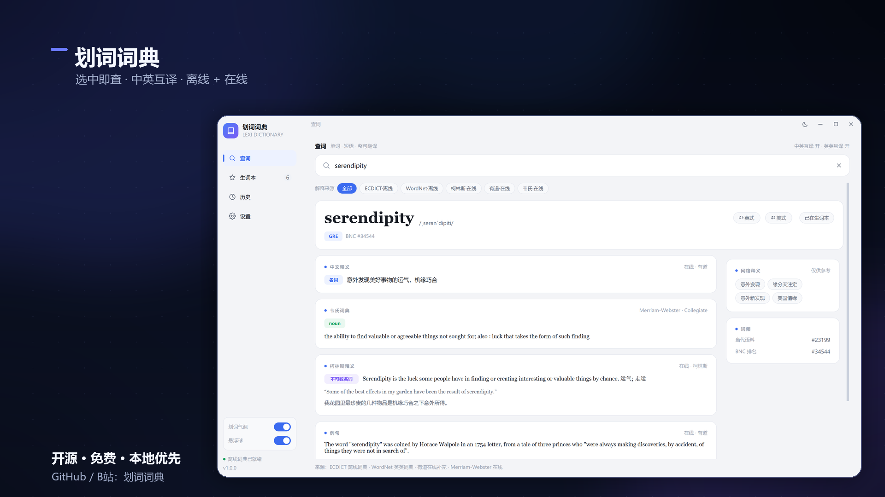
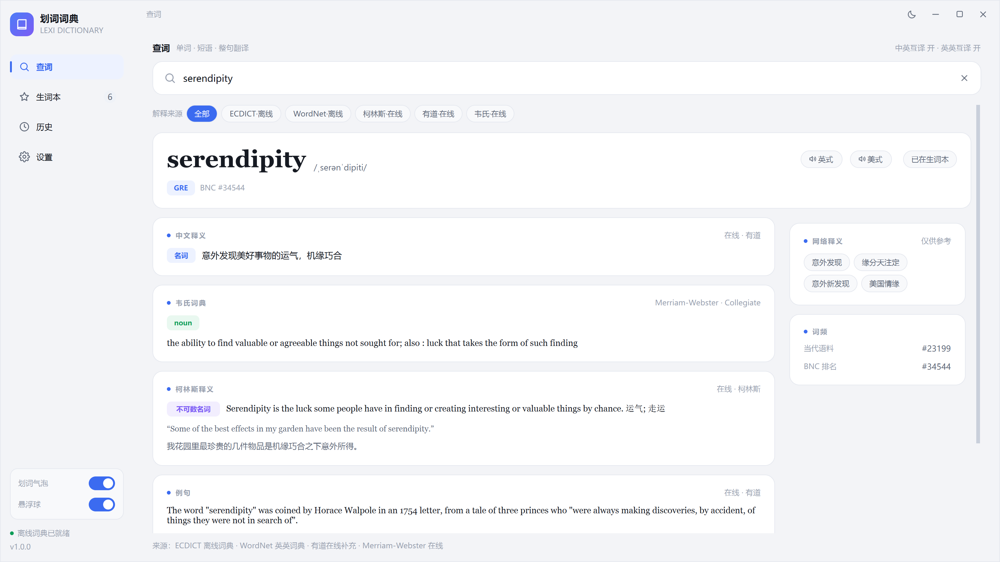
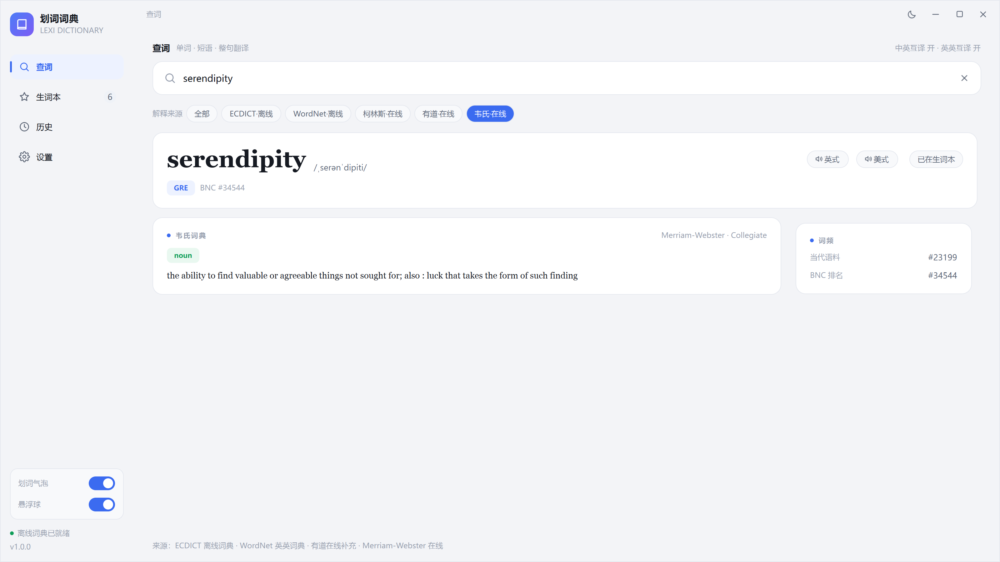
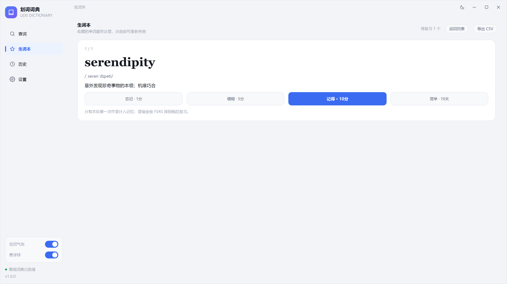

# 划词词典 · Lexi Dictionary

一个轻量、干净、**划词即查**的 Windows 中英词典。

选中文字 → 出现小标志 → 点开才查；不点，它不会打扰你。



[▶ 45 秒宣传片](docs/media/lexi_promo.mp4) · [B站](https://www.bilibili.com/video/BV1iP4V6wEwc)

## 功能

- **划词即查**：全局划词，只在选中文字后出现小标志
- **多来源**：ECDICT、WordNet、CC-CEDICT 离线；有道、柯林斯、Merriam-Webster、Datamuse 在线
- **中英 / 英英 / 整句翻译**
- **生词本 + FSRS-6**：忘记 / 模糊 / 记得 / 简单，按记忆状态安排复习
- **悬浮球**：快捷搜索、待复习角标、贴边收起
- **查询历史**：可勾选删除，也可一键清空
- **数据本地**：生词、历史、设置都在本机；支持备份 / 恢复
- **本地自定义词典**：可导入自己的 CSV / TSV / JSON / TXT 词库，只保存在本机
- **来源可选**：ECDICT / WordNet / 柯林斯 / 韦氏 / 有道；支持并列对照

## 截图

| 查词 | 多来源 |
| --- | --- |
|  |  |

| FSRS 复习 | 快捷搜索 |
| --- | --- |
|  |  |

## 下载（普通用户）

Windows 10/11 64 位，解压即用，不需要装 Python，也不需要管理员权限。

**[下载最新便携版 ZIP](https://github.com/yuluo-zero/lexi-dictionary/releases/latest)**

### 便携版使用

1. 下载 `lexi-dictionary-portable-v1.1.1.zip`（约 193 MB）
2. 如果 Windows 提示「已阻止此文件」或「来自网络」：
   - 先右键 ZIP → 属性 → 勾选「解除锁定」→ 再解压
   - 或解压后在 PowerShell 运行：
     ```powershell
     Get-ChildItem -Recurse | Unblock-File
     ```
3. 解压到任意固定目录，例如 `D:\划词词典`
4. 双击 `start.cmd` 启动
   - 不想看到命令行窗口，双击 `start.vbs`
   - 如果启动脚本仍被拦截，直接运行：
     ```powershell
     runtime\pythonw.exe main.py
     ```
5. 数据都在解压目录：
   ```
   data/settings.json   设置
   data/user.db         生词本、历史、FSRS
   data/dict/           离线词典
   ```

删除整个文件夹即卸载；换电脑时整个文件夹复制走即可。

- 不要删除 `runtime/` 和 `data/dict/`
- 不包含 API Key、个人设置或用户数据
- 在线词典需要联网；韦氏 Key 需自己申请并填入设置

## 运行（源码）

需要 **Windows 10/11**、**Python 3.12+**。

```powershell
git clone https://github.com/yuluo-zero/lexi-dictionary.git
cd lexi-dictionary

py -3.12 -m venv .venv
.venv\Scripts\activate
pip install -r requirements.txt

python main.py
```

## 离线词典

仓库**不包含**词典数据库（体积大，且各自有许可证）。首次运行前，把以下文件放进 `downloads/`：

| 文件 | 来源 |
| --- | --- |
| `ecdict.csv` | [ECDICT](https://github.com/skywind3000/ECDICT) |
| `cedict.txt.gz` | [CC-CEDICT](https://www.mdbg.net/chinese/dictionary?page=cc-cedict) |
| `wordnet.zip` | [Princeton WordNet](https://wordnet.princeton.edu/)（NLTK 语料包格式） |

然后构建：

```powershell
python tools/build_dicts.py data\dict
```

生成：

```
data/dict/ecdict.db
data/dict/cedict.db
data/dict/wordnet.db
```

没有离线库时，在线查询仍可使用，但启动会提示离线词典缺失。

## 本地自定义词典

可以把自己有权使用的词库导入本机：

**设置 → 本地词典 → 导入 CSV / JSON**

支持：

- CSV：`word,phonetic,translation,definition`
- TSV：同上，用 Tab 分隔
- JSON：对象数组，或 `{"word": "释义"}`
- TXT：`word<Tab>phonetic<Tab>translation<Tab>definition`

示例：

```csv
word,phonetic,translation,definition
optimise,ˈɒptɪmaɪz,使最优化,to make as effective as possible
```

说明：

- 只保存在本机 `data/user.db`
- 不会上传 GitHub、B站或便携包
- 不上传到任何在线服务
- `.mdx` / `.ld2` 是专有格式，需要先在词典软件里导出为 CSV/TSV/JSON/TXT
- 请确认你对该词库有本地使用和转换权限；商业词典不要随应用分发

## 在线词典 / API Key

- 有道：公开接口，无需 Key
- 柯林斯：经有道公开接口读取
- **Merriam-Webster**：需要自己申请免费 Key  
  <https://dictionaryapi.com/>  
  在应用「设置 → 词典来源」里填 Collegiate / Learner's Key
- 翻译：MyMemory / Google / DeepL（DeepL 需要 Key）

> API Key 只保存在本机 `data/settings.json`，不会上传仓库。  
> 免费版韦氏额度约 1000 次/天/Key，仅非商业使用。

## 技术栈

- Python 3.12 + PySide6
- SQLite（ECDICT / CC-CEDICT / WordNet / 生词本）
- 全局低层鼠标/键盘钩子 + 剪贴板保护
- FSRS-6（vendored `app/vendor/fsrs`，MIT）
- 原创合成宣传片 BGM

## 数据与许可

- 代码：[MIT](LICENSE)
- 完整第三方声明：[THIRD_PARTY_LICENSES.md](THIRD_PARTY_LICENSES.md)
- FSRS：MIT，见 `app/vendor/fsrs/LICENSE`
- ECDICT：MIT
- WordNet：Princeton WordNet License
- CC-CEDICT：CC BY-SA 4.0
- PySide6 / Qt：LGPL-3.0
- Python：PSF License
- 有道 / 柯林斯 / Merriam-Webster：在线接口，遵循各自服务条款
- 仓库不包含词典数据库；便携包会附带数据库，并随包附带完整许可证文本

## 说明

这是一个个人向的轻量词典项目，不是牛津/剑桥/韦氏官方产品，也不替代它们的完整授权版本。

